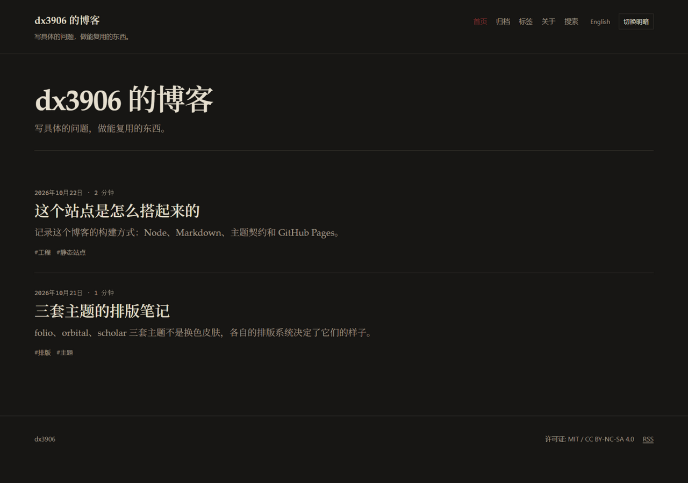

# endpaper

自研静态博客引擎。中文默认发布在站点根路径，英文在 `/en/`；主题可整体替换；构建时完成 Markdown、Shiki 代码高亮、KaTeX 公式和 Pagefind 索引。

这个仓库是可安装的构建系统包，不是任何人的个人博客。`content/`、`site.config.ts` 和主题截图只用于演示、测试和验证构建链；博客仓库只保留 `content/`、`site.config.ts`、`public/`、`package.json` 和部署工作流。构建系统仓库本身只跑 CI，不部署站点。



## 特性

- 中文在 `/`，英文在 `/en/`，不生成 `/zh/`，不做浏览器语言自动跳转
- 三套完整主题：`folio`（编辑排版）、`orbital`（复古未来主义）、`scholar`（学术）
- 站点身份、语言、导航、域名、许可证、主题全部在 `site.config.ts`
- Markdown + YAML frontmatter，构建时渲染，客户端零框架
- 标签、归档、分页、Atom、sitemap、robots、404、SEO/OG、JSON-LD
- Pagefind 全文搜索，按语言过滤，排除代码和公式
- KaTeX 构建时渲染，仅数学页面加载 CSS
- 确定性构建、内部链接检查、SEO 检查、主题一致性测试
- 构建系统仓库跑 Ubuntu + Windows CI；博客实例通过 `templates/deploy.yml` 部署 Pages，部署后 smoke test

## 构建系统开发

需要 Node.js 24 或更高版本。仓库里的 `content/` 是演示/测试站点。

```bash
npm ci
npm run dev
npm run check
```

修改 `src/`、`themes/` 或演示内容会触发 dev server 重建。构建 npm 包：

```bash
npm run build:package
```

## 创建博客仓库

博客仓库不需要复制 `src/` 或 `themes/`，只安装引擎并放内容：

```bash
mkdir my-blog
cd my-blog
npm init -y
npm install github:dx3906999/blog-engine
npx endpaper setup
npx endpaper dev
```

`setup` 会生成 `site.config.ts`，询问作者、站点标题、英文站点信息、域名和主题。非交互使用：

```bash
npx endpaper setup --yes --force --name "Your Name" --url "https://example.com" --theme folio
```

博客仓库最终只需要：

```
content/
public/
site.config.ts
package.json
.github/workflows/deploy.yml
```

引擎、主题、检查脚本和 Pagefind 都由 `endpaper` 依赖提供。

## 博客仓库脚本

在博客仓库的 `package.json` 里加：

```json
{
  "scripts": {
    "dev": "endpaper dev",
    "build": "endpaper build",
    "build:all": "endpaper check",
    "preview": "endpaper preview",
    "new": "endpaper new",
    "clean": "endpaper clean",
    "setup": "endpaper setup"
  }
}
```

| 命令 | 作用 |
| --- | --- |
| `endpaper dev` | 本地开发，监听内容、主题和配置 |
| `endpaper build` | 生成 `dist/`，不建搜索索引 |
| `endpaper check` | 构建、链接、SEO、主题一致性、Pagefind 索引 |
| `endpaper index` | 只重建 Pagefind 索引 |
| `endpaper preview` | 静态服务 `dist/` |
| `endpaper new "标题" --slug hello-world --lang zh` | 新建文章目录和 frontmatter |
| `endpaper check:deterministic` | 连续构建两次并比较产物 |
| `endpaper check:theme` | 用当前内容构建全部内置主题 |
| `endpaper clean` | 删除 `dist/`、缓存和开发产物 |

生产预览：

```bash
npx endpaper build
npx endpaper index
npx endpaper preview
```

构建系统仓库自己的开发脚本仍然是 `npm run dev`、`npm run check`、`npm run build:package`。

## 站点配置

`site.config.ts` 是唯一的站点身份来源。主要字段：

- `identity.author`：姓名、邮箱、主页、头像
- `identity.social`：GitHub、邮箱、RSS 等
- `identity.repository`：可选的 owner/name，用于页脚源码链接
- `locales.default` / `locales.entries`：语言列表，中英文各自的标题、描述、tagline
- `site.url`：生产域名 origin；CI 会由 `configure-pages` 注入 `SITE_URL`
- `site.base`：站点根路径；项目页由 `SITE_BASE` 注入，例如 `/my-blog`。Windows Git Bash 本地模拟时加 `MSYS_NO_PATHCONV=1`，否则 `/my-blog` 会被转换成 Windows 路径
- `site.customDomain`：设置后生成 `dist/CNAME`
- `site.timezone`：日期展示时区
- `site.license`：页脚展示的代码/内容许可证
- `theme.name`：`folio`、`orbital` 或 `scholar`
- `theme.config`：主题自己的配置，由主题的 zod schema 校验
- `nav`：导航项，路径是语言无关的，渲染时自动加语言前缀
- `pagination.perPage`：每页文章数
- `features.search` / `features.math`：搜索和公式

所有内部链接由 helper 生成。项目页部署不要手写 `/` 开头的资源路径。

## 内容

```
content/
  zh/posts/how-this-site-works/index.md
  zh/posts/how-this-site-works/cover.jpg
  en/posts/how-this-site-works/index.md
  zh/pages/about.md
  en/pages/about.md
```

Frontmatter：

```yaml
---
title: 标题
date: 2026-10-22T10:00:00+08:00
updated: 2026-10-23T09:00:00+08:00
tags: [工程, 静态站点]
slug: how-this-site-works
translationKey: how-this-site-works
summary: 可选的摘要
draft: false
---
```

规则：

- `date` 必须带时区偏移
- 文章和页面的 `slug` 只用小写 ASCII、数字和连字符
- `translationKey` 相同的文章互为译文，默认取目录名
- 同目录的图片会复制到文章输出目录，Markdown 用相对路径引用
- 草稿在开发模式可见，生产构建排除；未来日期的文章默认排除
- 数学用 `$...$` 和 `$$...$$`；代码块用围栏语法

详细说明见 [docs/authoring.md](docs/authoring.md)。

## 主题

| 主题 | 定位 | 更换方式 |
| --- | --- | --- |
| `folio` | 独立杂志 / 文学期刊；衬线正文、大留白、细规则线 | `theme.name: 'folio'` |
| `orbital` | 70 年代技术手册 / CRT 终端；等宽元信息、网格、磷光强调色 | `theme.name: 'orbital'` |
| `scholar` | 期刊论文；摘要、编号章节、左侧目录、打印样式 | `theme.name: 'scholar'` |

本地预览某套主题：

```bash
npx endpaper dev --theme=orbital
npx endpaper dev --theme=scholar
```

主题目录包含 `theme.json`、`theme.ts`、`layouts/`、`assets/`、`i18n/`。新增主题的接口说明见 [docs/theming.md](docs/theming.md)，三套主题的截图见 [docs/theme-gallery.md](docs/theme-gallery.md)。

## 部署博客实例

构建系统仓库不部署自身。部署工作流是 `templates/deploy.yml`，由博客仓库复制后使用。

1. 创建博客仓库，`npm install github:dx3906999/blog-engine`，放好 `content/`、`site.config.ts` 和 `public/`。
2. 把 `templates/deploy.yml` 复制到博客仓库的 `.github/workflows/deploy.yml`。
3. Settings → Pages → Build and deployment → Source 选择 **GitHub Actions**。
4. 推送博客仓库的 `main`；工作流会完成主题检查、构建、Pagefind、上传 artifact 和部署。
5. 部署后运行 smoke test，检查中英文首页、feed、sitemap、404 和搜索索引。

项目页部署时，站点根是 `https://<user>.github.io/<repo>/`。`actions/configure-pages` 会注入 `origin` 和 `base_path`，不需要在配置里写仓库名。

自定义域名：

- 在 `site.config.ts` 设置 `site.customDomain`，构建会生成 `dist/CNAME`
- 在 Pages 设置里填写域名并按 GitHub 的说明配置 DNS
- 开启 Enforce HTTPS

GitHub Pages 没有服务端重定向和自定义响应头；站点总大小限制 1 GB，带宽 100 GB/月，构建频率 10 次/小时。详细部署说明见 [docs/deployment.md](docs/deployment.md)。

## CI/CD

- `.github/workflows/ci.yml`：构建系统仓库的 CI；PR 和 `main` 推送；Ubuntu + Windows；跑 `npm run check`、确定性检查、actionlint
- `templates/deploy.yml`：博客实例的部署模板，复制到博客仓库后使用；校验 → 主题检查 → `configure-pages` → 生产构建 → 输出检查 → Pagefind → 上传 artifact → 部署 → smoke test
- `.github/workflows/external-links.yml`：每周检查内容里的外部链接
- `.github/dependabot.yml`：每周更新 npm 和 GitHub Actions

## 目录

构建系统仓库：

```
themes/             folio / orbital / scholar（随包发布）
src/core/           配置、扫描、Markdown、路由、渲染、输出
src/theme/          主题 API、加载器、资源、i18n
src/cli/            bin 子命令、检查、Pagefind、开发服务器
src/assets/         search.js（随包发布）
scripts/            包构建时复制主题资源和 search.js
tests/              单元和集成测试
docs/               计划、架构、写作、主题、部署、设计检查
content/            演示站点（不随包发布）
site.config.ts      演示配置（不随包发布）
templates/deploy.yml 博客仓库部署模板
```

博客仓库：

```
content/            文章和页面
public/             favicon、CNAME 等
site.config.ts      站点配置
package.json        依赖 endpaper
.github/workflows/deploy.yml
```

## 设计原则

三套主题不是换色皮肤。界面避免紫色渐变、玻璃拟态、通用 3D 插画、emoji 标题和空泛文案；示例内容写具体的技术或排版问题。完整检查项见 [docs/design-review.md](docs/design-review.md)。

## 许可

- 代码：MIT，见 [LICENSE](LICENSE)
- 内容：CC BY-NC-SA 4.0（可在 `site.config.ts` 中调整声明）
